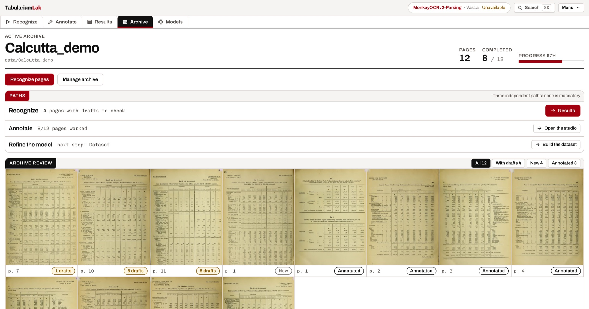
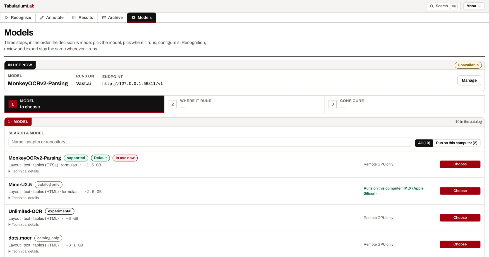

# Tabularium

**A local-first studio that turns archives of dense, borderless tables into
structured, reviewable data and, when you need it, fine-tunes the parsing
model on your own corpus.**

[](https://github.com/nbadino/tabularium/actions/workflows/ci.yml)
[](LICENSE)

Start with the [quickstart](#quickstart), or jump to
[what works on your computer](#platform-boundaries),
[model setup](#connecting-a-model-optional), or
[troubleshooting](#troubleshooting).

You choose a model and where it runs once (this machine or a rented GPU) and
then work the same way everywhere. Three independent paths, none of them
mandatory:

```
Recognize          select pages → recognize → review results → correct or export
Annotate           blocks, tables, reading order, transcription: your gold pages
Refine the model   dataset → fine-tune → evaluate → recognize again with it
```

Many archives only ever need the first path. Annotation stands on its own, and
fine-tuning is the optional branch for when the base model is not good enough
on your pages.

It was built for, and is in daily use on, historical registers (shipping
indexes, 1900s–1970s): pages whose tables have **no ruling lines**, hand-set
columns that drift down the page, and hundreds of cells per page. Nothing in it
is specific to that corpus: any archive of table-heavy pages works the same way.

> *Tabularium*: the public archive where ancient Rome kept its *tabulae*:
> the records **and** the tables.


*A page of the 1912–13 Annual Statement of Sea-borne Trade (no ruling lines) in
the table workspace: the scan on the left, the grid Tabularium proposed and a
person corrected on the right: 68 × 12 cells, 672 of 677 verified, 24 of 25
column sums adding up.*

---

## What it does

### 1. Register your archive

Point a project at a folder of scans (images or multi-page PDFs). Every page is
registered with the metadata your domain needs (issue date, issue number, page
number, page type), and previews are generated on demand, however large the
scans are. The source files are never modified.



### 2. Choose a model and where it runs

The **Models** screen is a three-step path, in the order the decision is made:
**model → where → configure**.

- **Model**: MonkeyOCRv2-Parsing, MinerU2.5, PaddleOCR-VL, Qwen3-VL and other
  document-parsing models, or any Hugging Face repo you add.
- **Where**: this machine (NVIDIA/CUDA, or Apple Silicon for models with a
  verified MLX port) or a remote GPU (SSH, Vast.ai, RunPod, Modal). Each option
  says *before* you click whether it can host that model, and why not.
- **Configure**: a checklist that follows what is actually true right now:
  weights → server → check locally; account → GPU → server → connection on
  Vast.ai. A refresh never loses a long preparation.

Runtimes (vLLM, MLX, the PaddleOCR-VL pipeline) are installed by Tabularium
itself on first use: no manual virtualenvs, no environment variables.



### 3. Recognize pages in bulk

Select a page, a range or a whole archive and start a recognition session. Each
page's result is saved as it arrives, and sessions belong to the backend: they
keep running if you close the browser. When the queue is done you can switch
the model off; everything after that works without a GPU.

Two engines, chosen explicitly:

- **Local OCR** (RapidOCR / PaddleOCR, CPU): detects text lines; with table
  promotion on, the largest cluster of lines whose geometry proves a grid
  becomes a `Table` block with its cells filled **cell by cell**.
- **The model**: returns blocks already classified, in its native mode.


### 4. Review, correct, export

**Results** lists every page of a session (completed, empty, failed, still to
check) and opens any of them in the studio. Generated content is a **draft**
(`verified: false`) until someone confirms it. Export either the original model
output or the current, corrected version, as JSON, CSV or plain text.


### 5. Annotate in a purpose-built studio

- **Blocks**: rectangles and polygons on a zoom/pan canvas, a label palette,
  drag/resize, undo/redo, keyboard shortcuts, autosave.
- **Reading order**: explicit ordering with a "flow" preview that walks the
  page the way a reader would.
- **Transcription**: per-block text with the project's transcription rules
  always at hand, so annotators stay consistent.
- **Borderless tables**: Tabularium **proposes the grid** of a table crop from
  the baselines of the glyphs, with column boundaries that follow the drift of
  hand-set columns instead of cutting through numbers. You correct it in a
  spreadsheet-style workspace with merged cells, column actions (trim, fill down,
  split, join…), cell-by-cell verification and arithmetic checks on column sums,
  inside the studio or on a second screen.


### 6. Refine the model (optional)

- **Dataset**: one click builds the JSONL families the official ms-swift
  training expects: layout (full page, coordinates normalized 0–1000, reading
  order), text recognition (crops + transcriptions) and table recognition
  (full table crops + **OTSL**). Splits are deterministic and **by page**, never
  by crop, and a health report lists what is still unverified.
- **Fine-tuning**: Tabularium generates and launches the *official*
  `swift sft` scripts (LoRA or full SFT) with a **VRAM preflight** that refuses
  runs your GPU cannot fit and proposes the largest sequence length that will;
  live logs, loss and GPU charts, stop and resume; immutable run recipes and
  SHA-256 artifact manifests. LoRA merge into a vLLM-servable checkpoint is a
  tracked follow-up, not yet offered.
- **Evaluation**: approved pages scored on layout (IoU per label), reading
  order, per-cell CER/WER and table structure, with a GT-vs-prediction overlay
  and the worst failures one click from the editor. Run it before training too:
  the base model's score is the baseline to beat.
- **Playground**: try any model on any page without saving anything.

### Self-hosted, multi-user

First launch creates the instance administrator; login uses HttpOnly session
cookies; global roles (admin / editor / viewer) plus per-project sharing.
Passwords and session tokens are stored only as hashes. The interface speaks
English, Italian and French, and ⌘K (Ctrl+K) jumps to any section, project or
page.

---

## Requirements

| Component | Requirement |
|---|---|
| OS | Linux, macOS or Windows |
| Python | 3.11–3.13 (backend; CI-verified) |
| Node.js | 22 (CI-verified; used by `run.sh`/`run.ps1` to build the frontend) |
| Storage | SQLite (bundled), plus disk space for your scans |
| GPU | Only for model recognition, evaluation and fine-tuning: NVIDIA with ≥ 8 GB, Apple Silicon for MLX-ported models, or a remote GPU |

Annotation, review, export and local-OCR prefill run entirely on CPU. The
dashboard process never imports PyTorch: model serving and training run in
separate environments it orchestrates.

### Platform boundaries

| Activity | Linux | macOS | Windows |
|---|:-:|:-:|:-:|
| Archive, annotation, review, export | Yes | Yes | Yes |
| Local OCR prefill on CPU | Yes | Yes | Yes |
| Local model serving on NVIDIA/CUDA, fine-tuning | Yes | No | Via WSL2 |
| Local model serving with MLX (selected models) | No | Apple Silicon | No |
| Remote GPU through SSH, Vast.ai, RunPod or Modal | Yes | Yes | Yes |

Which models run locally depends on the pair *machine + model*, and the Models
screen says so per model. The measured matrix is in
[docs/LOCAL_INFERENCE_GUIDE.md](docs/LOCAL_INFERENCE_GUIDE.md) §0. CI runs the
full backend and frontend test/build cycle on macOS as well as Linux.

## Quickstart

Tabularium runs as a local web app: the backend serves the dashboard at
`http://localhost:8787`. You do not need a GPU to organize scans, annotate pages,
or build datasets. Model inference and fine-tuning can use a remote GPU.

### Before you start

- macOS, Linux, or Windows;
- Python 3.11–3.13 and Node.js 20–22;
- internet access for the first dependency installation.

Tabularium is currently installed from source; prebuilt `.app` and `.exe`
installers are not published yet. Download the repository with **Code →
Download ZIP** on [GitHub](https://github.com/nbadino/tabularium), extract it,
and open a terminal in the `tabularium` folder. The setup scripts create the
app environments and build the web interface.

```bash
# macOS / Linux
./scripts/setup_backend.sh
./scripts/setup_frontend.sh
./scripts/run.sh
```

On Windows, run these PowerShell scripts in order:

```powershell
scripts\setup_backend.ps1
scripts\setup_frontend.ps1
scripts\run.ps1
```

Then visit **<http://localhost:8787>**. The first visit asks you to create an
administrator account. Keep the terminal window open while using the app;
press `Ctrl+C` there to stop it.

To start again later, run `./scripts/run.sh` (Windows:
`scripts\run.ps1`). It rebuilds the frontend when needed. Project data is kept
in `data/` by default and stays on your machine.

The backend installers accept Python 3.11, 3.12 or 3.13 and explicitly refuse
versions outside the verified matrix.

**Linux prerequisites.** The bundled OCR engine depends on `opencv-python`,
which imports `libGL`/`glib`; on a headless box the setup prints the remedy if
the import fails:

```bash
sudo apt-get install -y libgl1 libglib2.0-0   # Debian/Ubuntu; equivalent elsewhere
```

On first launch the app shows the **setup screen** where you create the
instance administrator; later sessions start at the login page. For a
single-user machine without authentication, start the backend with
`TABULARIUM_AUTH=off`. Registration is closed by default; the administrator can
open it from **Settings**.

### Then

1. **Archive** → create a project on your scans folder and scan it.
2. **Models** → pick a model and where it runs (skip this to use local OCR only).
3. **Recognize** → select pages and start.
4. **Results** → check, open pages in **Annotate** to correct, export.

Model-specific serving details (exact vLLM flags, memory limits, the MLX and
PaddleOCR-VL pipelines, TeleOCR, custom repos) are in
[docs/LOCAL_INFERENCE_GUIDE.md](docs/LOCAL_INFERENCE_GUIDE.md); rented GPUs
(Vast.ai, RunPod, Modal, SSH tunnels) in
[docs/CLOUD_INFERENCE_GUIDE.md](docs/CLOUD_INFERENCE_GUIDE.md); tested GPU
profiles in [benchmarks.md](benchmarks.md). A catalog entry is not by itself a
promise that every checkpoint fits an 8 GB GPU.

### Comparing models on the same page

Point the non-destructive benchmark at already-running endpoints (one
`--target` per server); results are never written as labels:

```bash
PYTHONPATH=backend data/vllm-runtime/bin/python scripts/benchmark_models.py \
  --image path/to/page.jpg \
  --target monkeyocrv2-parsing,http://127.0.0.1:8888/v1,MonkeyOCRv2 \
  --target mineru2.5,http://127.0.0.1:8889/v1,mineru2.5 \
  --task layout --repeat 2 --output data/benchmarks/run.json
```

It records success/failure, latency, time to first token, tokens/s, output
validity and token usage. Use `--task end2end` for adapters whose layout
protocol is not verified.

### Optional extras

- **Page rectification**: *Align and compare* in the studio proposes a
  corrected page without touching your annotations; you accept or reject it.
  The only neural rectifier is the **official MonkeyOCRv2 preprocessor**, the
  same stage the model's own pipeline runs before parsing; alongside it there
  are rotation-only deskew and manual perspective/mesh corrections.
- **Alternative OCR engines**: see
  [docs/OCR_MODEL_ALTERNATIVES.md](docs/OCR_MODEL_ALTERNATIVES.md).

## Configuration

Everything has a working default; these environment variables are optional
overrides.

| Variable | Default | Purpose |
|---|---|---|
| `TABULARIUM_ROOT` | `<repo>/data` | data root (projects, database, crops, runs) |
| `TABULARIUM_HOST` / `TABULARIUM_PORT` | `127.0.0.1` / `8787` | server bind |
| `TABULARIUM_AUTH` | `on` | `off` disables authentication (single-user local mode) |
| `TABULARIUM_REGISTRATION_OPEN` | closed | `1` opens self-registration |
| `TABULARIUM_SESSION_TTL_DAYS` | `30` | session lifetime |
| `TABULARIUM_OCR_ENGINE` | `auto` | `rapidocr` or `paddleocr` |
| `TABULARIUM_VLLM_URL` | `http://127.0.0.1:8888/v1` | inference server endpoint |
| `TABULARIUM_VLLM_MODEL` | `MonkeyOCRv2` | served model name |
| `TABULARIUM_VLLM_MAX_PIXELS` | unset | cap on pixels sent to the layout model |
| `TABULARIUM_TRAIN_REPO` | unset | your own MonkeyOCRv2 checkout (otherwise cloned automatically) |
| `TABULARIUM_TRAIN_ENV` | `monkeyocrv2-train` | conda/venv name for training |
| `TABULARIUM_MODELS_DIR` | `<repo>/models` | local model checkpoints |

## How it's built

One backend process serves both the API and the built frontend:

```
backend  (FastAPI + SQLite + Pillow/NumPy; model clients; subprocess for training)
  services/   recognition sessions · table detection · OTSL encoding · dataset builder
              trainer orchestration · VRAM preflight · runtimes · auth/permissions

frontend (React 19 + Vite + TypeScript + Tailwind; Konva canvas; Univer spreadsheet)
  studio/     zoom/pan canvas · blocks · reading order · table workspace
  app/        auth gate · layout · command palette · i18n (English / Italiano / Français)
```

Design principles:

- **The data comes first.** Annotations are stored in source pixels with full
  provenance; model-specific formats (0–1000 coordinates, OTSL, JSONL) are
  produced only at export. Your annotations never get locked to one model.
- **Generated is not verified.** Everything a model or OCR proposes stays a
  draft until a person confirms it, and the dataset report says how much is
  still draft.
- **Nothing destructive is implicit.** Autosave preserves identifiers, and
  every operation that can remove work asks first.
- **The official stack is used, not forked.** Training scripts, prompts,
  coordinate conventions and the OTSL encoder match the official MonkeyOCRv2
  repo, which is referenced as an external checkout and never modified.

## Documentation

- **[AGENTS.md](AGENTS.md)**: the complete product spec, data conventions and
  the reasoning behind every design decision (Italian; the source of truth).
- **[PRODUCT.md](PRODUCT.md)**: what the product promises and its constraints.
- **[DESIGN.md](DESIGN.md)**: the interface design system.
- **[docs/](docs/)**: local and cloud inference guides, OCR engine alternatives.

## Development

```bash
# backend tests
cd backend && python -m pytest tests -q

# frontend: typecheck, unit/component tests, build
cd frontend && npm run typecheck && npm test && npm run build

# end-to-end smoke (needs a running instance and Chromium)
cd frontend && npm run test:e2e
```

Continuous integration runs the backend tests (Python 3.11–3.13), the frontend
checks, a macOS pass and the end-to-end workflow (`.github/workflows/ci.yml`).

### Versioning

The application version lives in `VERSION`; the version displayed by the
backend and the frontend package metadata are synchronized by the helper:

```bash
python3 scripts/version.py                 # show current version
python3 scripts/version.py bump patch      # 0.1.0 → 0.1.1
python3 scripts/version.py bump minor      # 0.1.0 → 0.2.0
python3 scripts/version.py bump major      # 0.1.0 → 1.0.0
```

After a bump, add user-facing notes under the new version in `CHANGELOG.md`,
review the changed files, then commit and tag the release (`vX.Y.Z`). The tag
is a version marker; release publishing is still a deliberate manual step.
See [CHANGELOG.md](CHANGELOG.md) for the format and history.

## Troubleshooting

**I forgot the administrator password.**
Reset it from the terminal; it uses the same hashing and session invalidation
as the app:

```bash
backend/.venv/bin/python scripts/reset_password.py          # list users
backend/.venv/bin/python scripts/reset_password.py admin    # interactive (hidden input)
```

Pass a second argument to set the password non-interactively. The data root
follows `TABULARIUM_ROOT` (default `<repo>/data`).

**The app doesn't start / the page is blank.**
The backend serves `frontend/dist`, so the frontend must have been built once
(`scripts/setup_frontend.sh`, or `cd frontend && npm run build`).
`scripts/run.sh`/`run.ps1` rebuild it automatically when its sources are newer
(or with `TABULARIUM_BUILD_FRONTEND=1`). Health is reported on `/api/health`.

**Recognition with a model, evaluation or the playground say the model is unavailable.**
They need a model being served: start one from **Models**. Everything else
(local OCR, annotation, review, export) works without it.

## License

[MIT](LICENSE) © Nicolò Badino

## Acknowledgments

- [MonkeyOCRv2](https://github.com/Yuliang-Liu/MonkeyOCRv2): the parsing
  model and training stack Tabularium fine-tunes. This repository never
  modifies the official checkout; it drives it.
- [ms-swift](https://github.com/modelscope/ms-swift): training framework
  (official fork bundled with MonkeyOCRv2).
- [RapidOCR](https://github.com/RapidAI/RapidOCR) /
  [PaddleOCR](https://github.com/PaddlePaddle/PaddleOCR): CPU prefill engines.
- [Univer](https://github.com/dream-num/univer): the spreadsheet surface of
  the table workspace.
