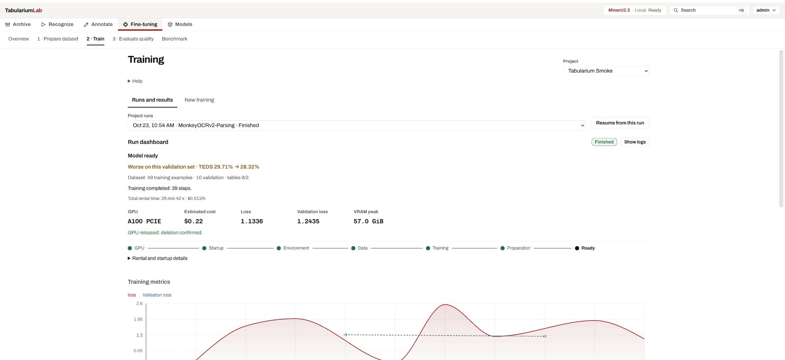
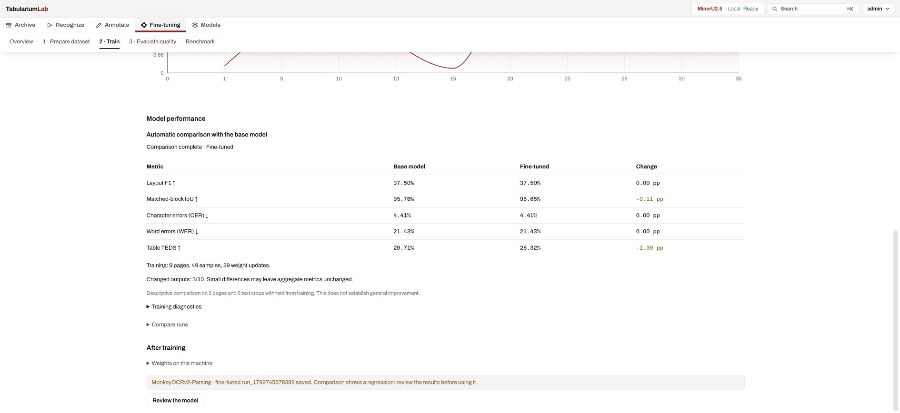

# Approval, export and training repair — 23 October 2026

## Root cause and completed repair

Eleven approved pages in project 1 had confirmed Table blocks, full grids and OTSL content,
but their cell verification flags were false. Readiness checked grid validity while approved-only
export checked individual verification flags. The earlier run therefore learned Table regions
in layout samples but received no table-recognition samples.

The user explicitly requested the workflow repair. Before changing flags, the original table
records and page revisions were backed up to
`data/repairs/approved_tables_20261023T081817Z.json`. Only confirmed tables on approved project-1
pages were reconciled; 11 tables and 6,822 cells received their already-approved page scope.
All 6,079 nonempty text cells are now verified. Every table's OTSL SHA-256 before and after
repair is identical: text, geometry and merged-cell structure were not changed.
The repair writes per-page `page.approval_reconciled` audit events and increments revisions.
Unapproved pages and model drafts outside this scope are unchanged.

Snapshot `v20261023T082545405602Z` contains:

| Family | Train | Validation |
| --- | ---: | ---: |
| Layout | 9 | 2 |
| Text crops | 31 | 6 |
| Full OTSL tables | 9 | 2 |

There are no table exclusions or warnings. The previous snapshot remains immutable and still
contains its original exclusion warnings. Preflight was verified to block that old snapshot,
while the rebuilt snapshot has no coverage blockers. All 11 approved pages pass readiness.

## Workflow changes

- Explicit page approval confirms table cells and block drafts, with source `page_approval`.
- Readiness requires verified table text cells for approval; the existing confirmation dialog
  states that all table contents are being accepted into the dataset.
- Approval advances the page revision, returns it and notifies other editors. Table editors
  refresh after acceptance so a stale copy cannot reset the verification flags.
- Assigned pages can be submitted to review with cell warnings; explicit reviewer approval
  accepts the reviewed cells and records the updated revision.
- Dataset `table_exclusions` records block/page/reason; preflight and automatic rental block
  approved-only datasets with excluded tables before spending money.
- Missing optional band boundaries do not warn when full tables were exported successfully.
- The dataset page waits for workflow data before claiming there are no approved pages.

## Evaluation quality

`table_similarity.py` implements tree-edit TEDS with APTED and PubTabNet's edit-cost convention
on canonical OTSL table/row/cell trees. The old row-aligned approximation is recorded separately.
Reference: https://github.com/ibm-aur-nlp/PubTabNet/blob/master/src/metric.py
Exact edit distance uses RapidFuzz, avoiding quadratic Python loops on whole-register strings.
A full-size table with one changed character produced a TEDS score of 0.9998878672 in 2.92 s.

## Live follow-up

The new run was launched through the browser with MonkeyOCRv2, LoRA rank 8 / alpha 32,
frozen ViT, 1e-5 learning rate, batch 4, accumulation 1, 16,384 sequence length and
1,003,520 pixels. This trial uses 3 epochs and evaluation every 13 steps; recipe defaults
remain unchanged. Automatic job: `auto_1792744083814`. Vast.ai instance `57345559` is an
A100 PCIE at USD 0.512963/hour, below the trial's USD 0.60/hour ceiling.
The normal pipeline trains, merges and compares both models on the same GPU, then downloads,
registers and releases it. Final metrics and verified cleanup are recorded after completion.

Browser evidence: [dataset with all 11 tables](screenshots/dataset-tables-reconciled-20261023.png).

## Live monitor follow-up

The first corrected-data trial (`run_1792744816887`) reached 39/39 steps
(train loss 1.4657596, validation loss 1.23181617), but the remote process monitor
classified it as failed. The instance was deleted before checkpoint recovery and
paired evaluation. These losses do **not** establish an improvement over the base.
Provider deletion of instance 57345559 was independently confirmed (empty list).

The monitor now distinguishes workflow stage, next action, stage duration, total
rental duration, dataset composition, actual optimizer steps and trainer-reported
remaining time. Container download/verification/extraction are named when the
provider supplies that information; no synthetic percentage is shown. Raw logs
remain behind their button. A final training step is explicitly distinguished from
a registered, evaluated model.

Remote exit status uses a marked response to tolerate provider banners. A missing
exit file receives a bounded grace period; artifact retrieval is attempted even
when the remote command reports failure. Empty remote artifact manifests fail
validation. Transfer telemetry is stored in a separate activity sidecar to avoid
racing run metadata writes. Metrics include actual ms-swift steps and totals.

A second real trial, `auto_1792745650254` / `run_1792745678399`, uses the same frozen
49/10 examples (9/2 table samples), 3 epochs and evaluation every 13 steps. Instance
57348419 is an A100 at $0.512963/hour, with a separate 45-minute safety deadline.
Final comparison and deletion confirmation are pending.

### Paired result on the corrected dataset

The second trial completed training with remote exit code **0**, recovered the
checkpoint, merged it on the same A100, and completed **20/20 paired evaluations**
before starting the merged-model download. Nine approved training pages and two
held-out pages remained disjoint; both table crops were evaluated for both models.

| Metric | Base | Fine-tuned | Change |
|---|---:|---:|---:|
| Layout F1 | 37.50% | 37.50% | 0.00 pp |
| Matched layout IoU | 95.7556% | 95.6451% | −0.1105 pp |
| Text CER | 4.4118% | 4.4118% | 0.00 pp |
| Text WER | 21.4286% | 21.4286% | 0.00 pp |
| Table TEDS (APTED) | 29.7080% | 28.3207% | **−1.3873 pp** |

**This trial regressed on this small validation set.** Three of ten outputs changed.
It does not justify replacing the active inference model or claiming an improvement.
The base revision was `e8871a0057c98378219b369f924a25ba10f392bf`; generation
used temperature 0, top-p 1, seed 42 and the official MonkeyOCRv2 pixel cap.
Text covers only 68 characters / 14 words, so it is not evidence about full-page text.

The first table contributes nearly all of the regression: TEDS 6.5390% → 3.7422%;
the second is effectively unchanged (52.8770% → 52.8993%). On the first, the gold
matrix is 67×11, versus 153×7 predicted by the base and 190×9 by the fine-tuned
model. This is a measured structural failure, not an absence of table training data.
No annotations or frozen references were changed to improve the reported score.

Independent transfer verification used a separate temporary directory on the same
GPU: **3/3 files, 78/78 bytes, exit 0, one artifact checksum verified**. It confirmed
the latest directory filtering, log exclusion and framed-manifest handling without
changing the researcher run.

The UX now separates training and validation loss curves, makes the comparison
verdict visible in the primary summary, and keeps token accuracy under training
diagnostics. Token accuracy is not presented as OCR quality. The final GPU deletion
and model-registration status are recorded below once verified.

### Closure (verified)

- Registered model: `custom-monkeyocrv2-parsing-run-1792745678399`.
- Preparation ended at `2026-10-23T09:19:42.880731+00:00`.
- Automatic workflow finished; instance **57348419** deletion confirmed independently
  through the Vast.ai API: **no instances remaining**.
- Total workflow/rental estimate: 25 min 42 s at $0.512963/hour, about **$0.22**.
  This is an estimate, not the provider invoice.
- The existing active inference model remained MinerU2.5 Local Ready.
- Frontend production build and Python syntax checks passed. Browser verification
  covered live steps/ETA, phase logs, paired metrics, saved model, GPU release and
  monitor persistence after refresh. No unit test suite was run.
- Latest transfer implementation was verified on the same GPU with an isolated
  temporary file. Per-package installation telemetry was added after installation
  had begun; it is activated for subsequent runs, not claimed as observed in this run.
- Regressed models are saved for review; the final action no longer presents them
  as an improved model to deploy. Completed download bars and repeated completed
  preparation steps are hidden, while logs and model weights remain accessible.

