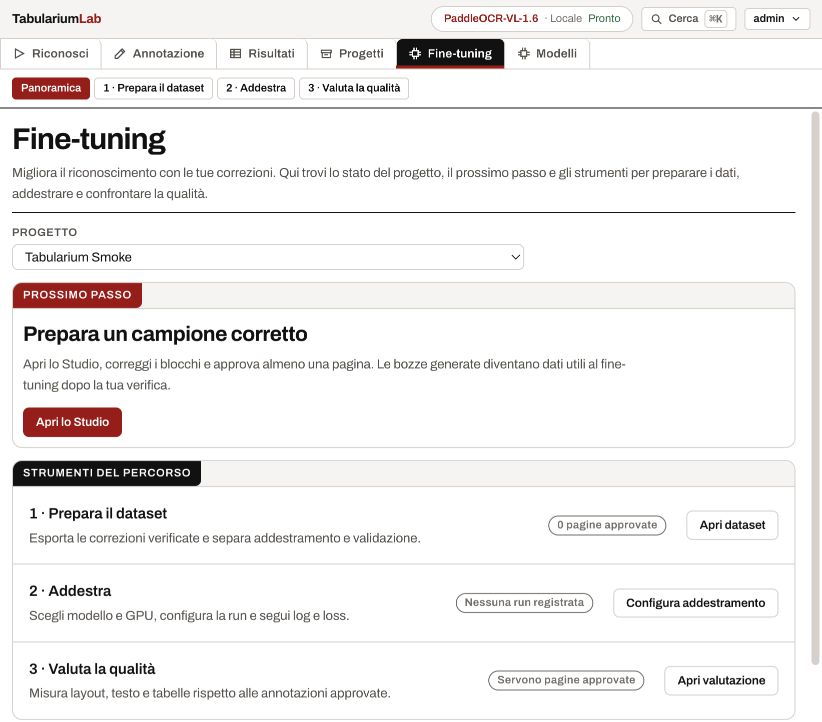
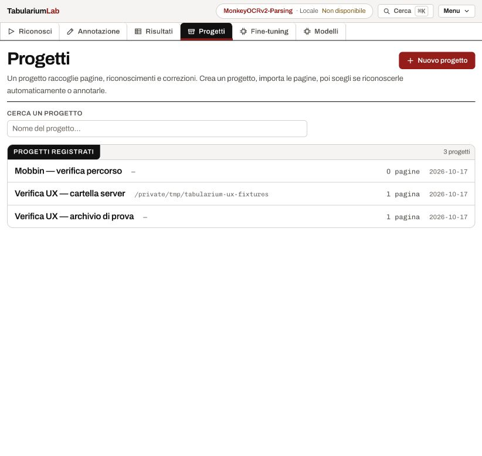
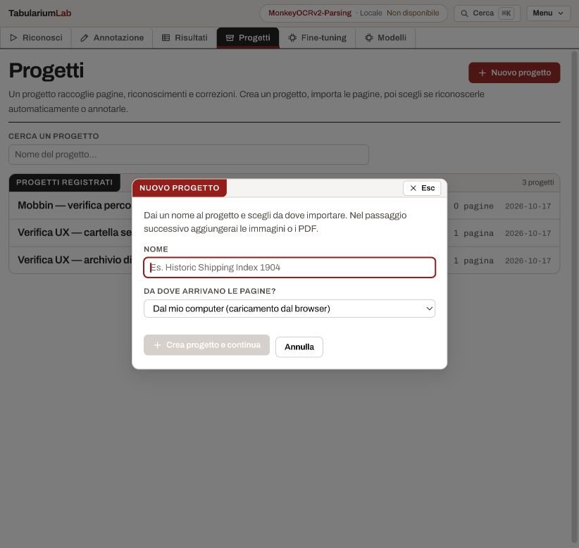

# Revisione usabilità con Mobbin — 17 ottobre 2026

Seconda iterazione di [UX_WORKFLOW_AUDIT.md](UX_WORKFLOW_AUDIT.md). I riferimenti
sono stati cercati tramite Mobbin MCP ed esaminati nelle immagini delle schermate
e dei flussi, mantenendo il sistema visivo di Tabularium.

## Riferimenti e applicazione

| Riferimento Mobbin | Osservazione sulle schermate | Applicazione in Tabularium |
| --- | --- | --- |
| [Jasper — Progetti](https://mobbin.com/screens/df7e838c-7b55-42bd-bc44-937643112f63) | Elenco, ricerca e pulsante di creazione sono separati dal modulo. | Progetti apre l’elenco con ricerca per nome e «Nuovo progetto» in testata. |
| [GitLab — Progetti](https://mobbin.com/screens/62ceb090-e212-467b-9952-5896f14a14c4) | Il comando Nuovo progetto è visibile accanto al titolo; la ricerca filtra la lista sottostante. | Ricerca con stato senza corrispondenze e comando per cancellare il filtro. |
| [Copilot — Creazione progetto](https://mobbin.com/flows/9a1d4ac4-e160-4bc7-8a70-d4b02ed82403) | La creazione si apre in una finestra dedicata e termina nel progetto. | Dialogo raggiungibile anche da `/progetti?nuovo=1`, con ritorno al progetto creato. Import successivo, come già previsto dall’API di Tabularium. |
| [Asana — Importazione file](https://mobbin.com/flows/24044b8f-3b0c-461c-9b9b-5cc91142148f) | L’importazione presenta un compito preciso con una breve spiegazione e un’azione esplicita. | Nella pagina progetto le istruzioni di import restano leggibili; si riducono i duplicati nello stato vuoto. |
| [Cohere — Creazione modello chat](https://mobbin.com/flows/cf96b131-307d-45e9-8932-ab9a34272b54) | La panoramica introduce l’attività prima dei passi tecnici; il flusso separa dati, revisione e configurazione. | Fine-tuning apre una panoramica con prossimo passo, stato e accesso agli strumenti. |
| [Cohere — Stato del modello](https://mobbin.com/screens/dd89e83a-58b4-4483-9b75-b41581b17c6b) | Stato, dati e prestazioni sono visibili nel contesto del modello. | Ogni strumento nella panoramica dichiara lo stato disponibile del progetto. Non si inventano metriche o avanzamenti. |

## Interventi

1. **Progetti: prima l’elenco.** Il modulo permanente sottraeva spazio a chi
   voleva tornare al lavoro. Ora compare su richiesta, con ricerca nell’elenco e
   recupero esplicito quando non ci sono corrispondenze.
2. **Fine-tuning: orientamento prima della configurazione.** Nuova rotta
   `/fine-tuning`, con sottosezioni Panoramica / Dataset / Addestramento /
   Valutazione. Il prossimo gesto dipende dallo stato letto dal server:
   importazione, revisione, dataset, configurazione, monitoraggio o valutazione.
   Gli strumenti restano raggiungibili anche quando non sono il passo suggerito.
3. **Stati mancanti ed errori distinti.** La panoramica attende le risposte;
   un errore di rete espone un errore e un tentativo di ricaricamento, anziché
   dichiarare che il progetto non ha dati o run.
4. **Descrizioni leggibili.** `PageHeader` va a capo: non tronca più lo scopo
   della schermata in una riga con tooltip. Titolo e azione possono andare a capo.
5. **Azioni del progetto.** Eliminazione spostata in «Altre azioni», mantenendo
   la conferma esistente. Per i progetti con pagine si spiega la differenza fra
   riconoscimento persistente, annotazione e fine-tuning facoltativo.
6. **Modelli: ingressi coerenti.** Il collegamento al fine-tuning porta alla
   panoramica; la prova temporanea resta un’attività separata.
7. **Tastiera.** Le modali mantengono il focus durante la compilazione, senza
   riavviare il focus trap a ogni nuova callback del genitore. Il campo Nome
   riceve il focus all’apertura; Escape legge la callback corrente e restituisce
   il focus al comando di apertura. Tornare a Progetti dal rail non riapre un
   vecchio dialogo di creazione.

## Verifiche

- Browser, istanza reale in lettura: ricerca progetto, filtro vuoto, nuovo
  dialogo, digitazione continua, Escape, panoramica del progetto senza gold.
- Browser, istanza isolata con dati sintetici: creazione dal dialogo e arrivo
  nel progetto; panoramica per progetto vuoto, progetto da revisionare e dataset
  già costruito; navigazione verso dataset e strumenti; italiano, inglese e
  francese con conteggi corretti.
- Frontend: typecheck e build completati; **35 file, 207 test Vitest passati**.
  Regressioni aggiunte per ricerca/creazione, focus delle modali, prossimo passo,
  errore nel caricamento e ritorno all’elenco.
- Nessuna modifica al backend in questa iterazione. I limiti dell’audit iniziale
  su training GPU, valutazione VLM e collaborazione restano quelli documentati.
- Il progetto sintetico creato per il collaudo è nella radice temporanea
  `/tmp/tabularium-ux-audit`, separata dai dati dell’utente.

## Schermate dell’implementazione

