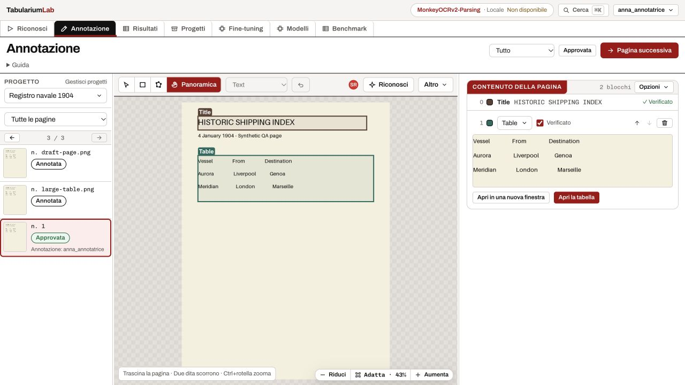
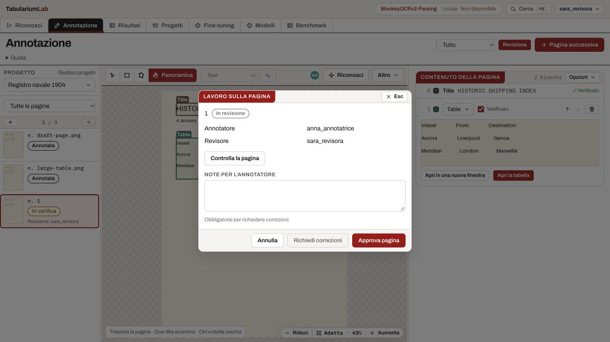
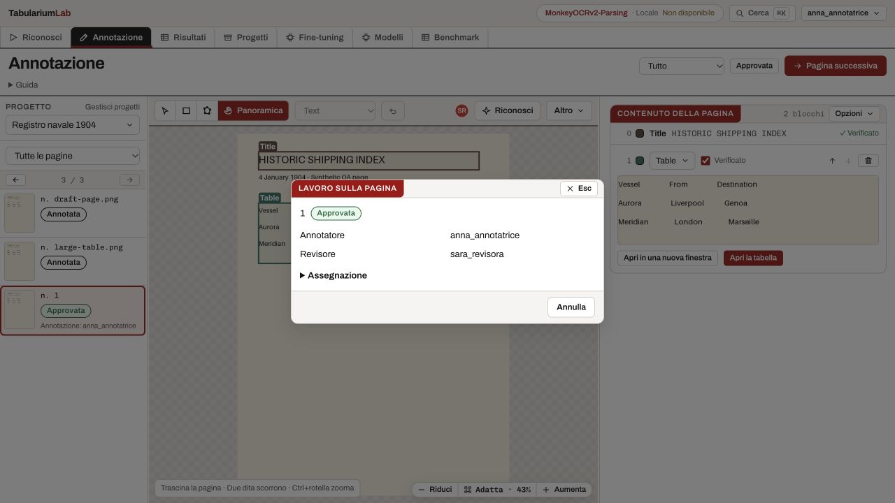
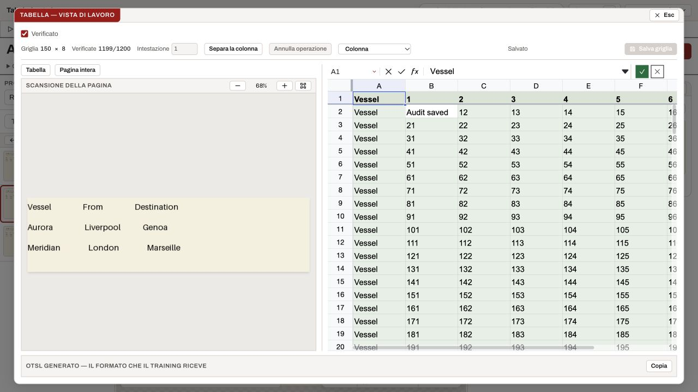

# Studio: usabilità, assegnazioni e revisione

Verifica del 18 ottobre 2026. Scenario: team interno con amministratore, annotatori e revisori.
Questa iterazione completa assegnazioni e passaggio alla revisione rinviati nell’analisi
[del workspace](UX_TEAM_WORKSPACE.md), e interviene sull’editor tabellare esistente.

## Percorso di lavoro

Il proprietario del progetto o un amministratore assegna una pagina a un annotatore e a un
revisore distinti. Entrambi devono già poter modificare il progetto: assegnare un’attività
non concede accessi. La lista delle pagine offre i filtri **Da annotare** e **Da revisionare**.
Il comando nella testata cambia con il lavoro: **Assegna pagina**, **Invia al revisore**,
**Revisiona**, oppure lo stato corrente.

L’annotatore salva e invia; il revisore può approvare o chiedere correzioni con una nota
obbligatoria. Dopo le correzioni serve un nuovo invio. Il server registra l’utente autenticato,
impedisce l’auto-approvazione e controlla sia la versione dell’assegnazione sia la revisione
delle annotazioni. I vecchi endpoint di approvazione singola, in blocco e di registrazione
recensioni non aggirano questo percorso sulle pagine assegnate. Una modifica successiva
all’approvazione riporta la pagina assegnata tra quelle da rivedere.

Le pagine senza assegnazione conservano il percorso di approvazione precedente. Non è stato
aggiunto un ruolo globale «revisore»: il compito sulla pagina si aggiunge al permesso editor.
L’assegnazione non blocca la modifica agli altri editor del progetto.

## Inventario e interventi

| Funzione | Comportamento e intervento |
|---|---|
| Progetto e pagine | Contesto da URL rispettato subito; apertura della prima attività personale disponibile; cambio pagina e progetto attendono i salvataggi di canvas e bozze |
| Coda personale | Filtri per annotazioni assegnate e revisioni in attesa, persona visibile vicino alla pagina; assegnazione per singola pagina |
| Viste dello Studio | Tutto, Solo canvas e Solo trascrizione sempre raggiungibili dalla testata; Solo canvas nasconde realmente il pannello contenuti |
| Spazio di lavoro | Tre colonne ridimensionabili; larghezze adattate allo spazio disponibile; eliminata una riga di comandi ripetuti sul canvas |
| Disegno e navigazione | Selezione, rettangolo, poligono e pan; scorciatoie P/H collegate agli strumenti; comandi del canvas disattivati quando la vista è nascosta o occupata dal prefill |
| Contenuti e ordine | Conteggio compatto, classe, verifica e trascrizione nel pannello; rinumerazione, regole, classi e schema tabella raccolti in Opzioni |
| Bozze | Scritture accodate con conservazione dell’ultima modifica; conferma, cambio classe e scarto sincronizzano la revisione; errore di salvataggio impedisce la navigazione interna pagina/progetto |
| Riconoscimento | Pulsante visibile; scelta motore nel dialogo prima dell’esecuzione, anche su pagina vuota; modalità Aggiungi / Sostituisci bozze / Sostituisci tutto conservate |
| Tabelle | Foglio e scansione affiancati; modifica testo, verifica, merge, righe/colonne, operazioni di colonna, OTSL e controlli aritmetici restano disponibili |
| Reattività del foglio | Selezione e scroll non serializzano il workbook; rimossi ritardo artificiale di montaggio e comparsa riga per riga; nascosti i comandi strutturali nativi duplicati |
| Salvataggio tabelle | Chiusura e ritorno allo Studio attendono il salvataggio; finestra separata recupera il contesto reale del blocco; PATCH/PUT/DELETE dello Studio inviano la revisione attesa |
| Collaborazione | Stato del passaggio di revisione aggiornato dal canale live; salvataggi concorrenti respinti con conflitto; nessuna fusione automatica delle modifiche |
| Rettifica e rilevamento geometrico | Percorsi esistenti conservati; nessuna estensione del rilevatore deprecato o modifica ai contratti dei pixel/master |

Il vecchio autosave poteva marcare come pulita una pagina modificata mentre una richiesta era
ancora in corso, oppure assorbire un errore e consentire la navigazione. Ora distingue la versione
delle modifiche locali, conserva lo stato sporco e propaga il fallimento. Le scritture esterne
(tabella, classe, conferma e trascrizione delle bozze) sono serializzate con il canvas.
L’avviso di modifica remota non resta visibile quando l’evento corrisponde al salvataggio appena
confermato dal server.

## Riferimenti Mobbin

Consultati attraverso Mobbin MCP, con anteprime effettivamente osservate:

- [Ditto — stato e assegnazione nel contesto del documento](https://mobbin.com/screens/e05f7c4f-20a9-4a25-ab85-84897a3f1b6d): azione di revisione e persona accanto al lavoro.
- [Framer — canvas con pannelli laterali](https://mobbin.com/screens/f4ea8508-4311-4c84-a9a6-a2b89eee8454): strumenti locali, canvas centrale, ispettore e navigazione persistente.

Questi riferimenti guidano gerarchia e posizione dei comandi; il flusso di annotazione resta
specifico di Tabularium.

## Verifica eseguita

Browser su istanza locale autenticata isolata, dati sintetici, due sessioni simultanee:

- assegnazione a due persone distinte; invio; richiesta di correzioni con nota; modifica del
  titolo; nuovo invio; approvazione del revisore; aggiornamenti live nell’altra sessione;
- ingresso e uscita da Solo canvas / Solo trascrizione; scorciatoie P/H;
- correzione di una bozza e cambio pagina immediato, ritorno con testo conservato, conferma
  della bozza e comparsa sul canvas;
- apertura del dialogo Riconosci con motore e modalità di sostituzione; apertura delle regole;
- foglio sintetico 150 × 8: modifica di B2, perdita della verifica sulla sola cella modificata,
  autosave, chiusura e riapertura con valore conservato; inserimento riga e annullamento.

Il foglio da 1.200 celle è uno stress test sintetico: la scansione dimostrativa accanto è una
piccola tabella e non costituisce ground truth di quel foglio.

Test automatici: 230 frontend e 76 backend mirati superati; typecheck e build superati.
Coprono fra l’altro permessi, migrazione, versioni obsolete e rollback, blocco dei percorsi di
approvazione alternativi, invio dopo flush, nota obbligatoria, salvataggi in corso, retry delle
bozze e selezione delle mutazioni del foglio. Le funzioni di griglia hanno test di struttura,
merge e provenienza. Non tutte le combinazioni degli strumenti sono state ripetute via browser.

## Limiti e lavoro successivo

- Assegnazioni per pagina, senza distribuzione in blocco o coda personale trasversale ai progetti.
- Revisioni ottimistiche, senza CRDT, lock della pagina o merge automatico. Il recupero di un
  conflitto può richiedere scegliere fra lavoro locale e versione sul server.
- Il cambio pagina/progetto interno attende il salvataggio; la chiusura del browser e altre
  uscite globali conservano il salvataggio d’emergenza, senza garanzia quando la rete è assente.
- Il bundle Univer resta grande (circa 1,68 MB gzip): eliminare il lavoro inutile durante l’uso
  non dimostra un miglioramento del caricamento iniziale su ogni macchina. Nessun benchmark
  prestazionale su archivio reale di grandi dimensioni è stato completato.
- Non eseguiti riconoscimento con GPU/provider, rettifica neurale o training durante queste
  prove; nessuna conclusione nuova sulla qualità del modello. Nessuna annotazione reale modificata.

## Follow-up — 23 ottobre 2026: testata dell’editor tabella

La parte superiore dell’editor è stata ridotta a due livelli. Il primo contiene il ritorno allo
Studio, il titolo breve con l’id del blocco e la verifica del blocco; il secondo contiene intervallo
selezionato, celle verificate, eventuali somme fallite, *Struttura*, annulla/ripeti e un solo
controllo di salvataggio. Dimensioni della griglia, righe di intestazione, separazione e azioni di
colonna sono dietro *Struttura*. Il passaggio ritaglio/pagina intera è un controllo a icone nella
testata della scansione; la chiusura delle finestre non stampa più la parola “Esc”. La spiegazione
lunga della verifica resta disponibile come descrizione accessibile e tooltip, senza occupare una
riga permanente.

Riferimenti Mobbin osservati per la gerarchia:

- [Supabase — Table Editor](https://mobbin.com/screens/498fe53a-4528-4853-a523-5bfc8cb3cd56): una
  testata unica per contesto e azioni, con la tabella come superficie principale.
- [Rows — spreadsheet workspace](https://mobbin.com/screens/bdd4f832-894d-426a-836d-d06ae0592060):
  controlli del foglio compatti e secondari rispetto ai dati.
- [Braintrust — dataset table](https://mobbin.com/screens/d85127c1-51dc-449e-8ba6-fe6c19d1efc2):
  stato e strumenti in una barra densa, senza duplicare i conteggi nel corpo.
- [OpenAI Platform — data table](https://mobbin.com/screens/4abaa3f1-e023-44bc-9b4c-63214e7e7f0a):
  navigazione a sinistra, azioni a destra e cambio vista compatto.

Verifica eseguita in browser sull’istanza locale, sia nella finestra dello Studio sia in
`/tabella/:blockId`: caricamento della griglia 71 × 9, menu *Struttura*, passaggio a pagina intera,
annulla/ripeti disabilitati senza storia, salvataggio nello stato pulito. Typecheck, build e 244 test
frontend superati.
