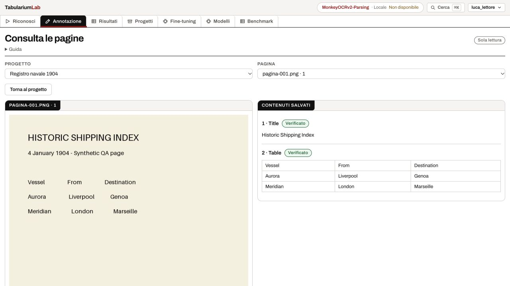
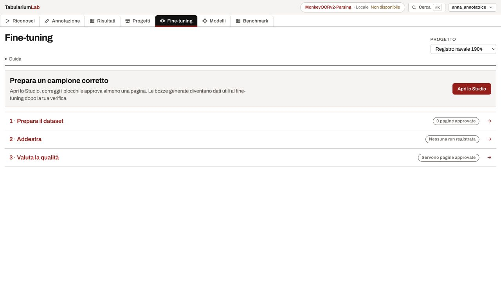
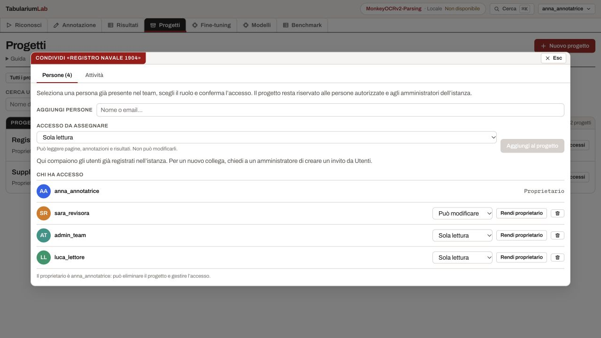

# UX del team e riduzione del carico visivo

Verifica del 18 ottobre 2026. Scenario scelto dall’utente: team interno con amministratore,
annotatori e revisori su progetti condivisi. La richiesta successiva dà priorità anche alla
rimozione di testi, titoli duplicati e attese nella navigazione.

## Problemi osservati e interventi

| Problema | Intervento realizzato |
|---|---|
| Non è chiaro chi possiede un progetto o perché sia visibile | Elenco con proprietario, accesso effettivo, persone attive e filtri propri/condivisi |
| Scegliere una persona le dava immediatamente accesso editor | Scelta della persona, scelta del permesso, pulsante esplicito Aggiungi; default sola lettura |
| Il ruolo globale può differire da quello sul progetto | Capacità calcolate dal backend nella risposta del progetto; nessuna deduzione dal solo ruolo globale |
| Un lettore entrava nell’editor | Consultazione separata di scansioni, testo e celle unite; nessun editor o autosave montato |
| Un URL diretto apre la tabella fuori dal contesto | Contesto risolto da GET del blocco protetto dal server; la query non determina il permesso o la pagina del blocco |
| Spiegazioni generali ripetute sopra ogni attività | PageHeader compatto e spiegazioni sotto Guida, chiusa di default |
| Fine-tuning ripeteva la navigazione, il prossimo passo e tre descrizioni | Una sola prossima azione, tre righe con stato e link; sottosezioni visibili entrando nei singoli strumenti |
| Menu e pagine sembravano attendere il loro turno | Rimossi 700 ms di apertura, ingressi delle voci con ritardi di 150–550 ms e 450 ms di chiusura; niente animazione globale al cambio pagina o comparsa dei moduli durante lo scroll |
| Ogni pagina chiedeva dati che non usa | Training evita un secondo status e la lista dei riconoscimenti; Dataset evita il secondo caricamento dataset e i riconoscimenti; Valutazione evita i riconoscimenti |

Non sono stati aggiunti cache dei permessi o caricamenti anticipati degli editor. Le letture dei
permessi restano aggiornate dal server; il grande bundle Univer resta caricato su richiesta.
La build segnala ancora il suo peso: questa iterazione non dimostra un miglioramento dei tempi
del foglio su archivi grandi né della latenza dei provider.

## Accesso effettivo

| Accesso al progetto | Consultare | Annotare / correggere / approvare | Gestire accessi / eliminare |
|---|---|---|---|
| Proprietario | sì | sì | sì |
| Editor, mostrato come Può modificare | sì | sì | no |
| Viewer, mostrato come Sola lettura | sì | no | no |
| Amministratore dell’istanza | sì, su tutti i progetti | sì | sì |

Il ruolo globale governa anche funzioni dell’istanza, come creare progetti o amministrare utenti.
Non sostituisce il permesso di membro. `ProjectOut.access` contiene ruolo, fonte, `can_edit` e
`can_manage`. `members_count` conta le persone attive assegnate, incluso il proprietario,
non tutti gli amministratori impliciti. Il dialogo dichiara l’accesso degli amministratori.
Un backend precedente che non restituisce le capacità non apre l’editor per membri non verificabili.

Il revisore che corregge o approva ha accesso editor. L’iterazione successiva introduce
assegnazioni e separazione tra annotatore e approvatore sulle pagine assegnate:
vedi [Studio e revisione](UX_STUDIO_REVIEW.md). La consultazione resta una superficie di lettura.

## Riferimenti Mobbin consultati

- [MagicPath — condivisione](https://mobbin.com/flows/8268ffe0-4c03-475a-bfe4-0b14f4dbcbd8):
  selezione di persone e ruolo prima dell’invito esplicito.
- [Descript — progetti e condivisione](https://mobbin.com/flows/5ec6803a-22d6-4379-af57-e10a46c47b4c):
  distinzione Owned by me / Shared with me e conferma della condivisione.
- [Height — workspace](https://mobbin.com/screens/6d955cd7-83eb-4b39-987c-65d3dd4196c9) e
  [Wrike — team](https://mobbin.com/screens/a34c0ecc-afaa-48fc-8230-8a1e436188cb):
  contesto del team vicino al lavoro. Non si introduce una dashboard di widget senza necessità.

## Verifica

Browser su istanza autenticata isolata, con pagine e account sintetici:

- proprietaria: elenco propri/condivisi, filtro condivisi, dialogo persone, scelta senza scrittura,
  aggiunta esplicita e aggiornamento del conteggio;
- lettore: vede solo il progetto condiviso, nessun comando Nuovo progetto, import e approvazione
  disabilitati nel dettaglio, nessuna eliminazione;
- Studio: scansione e tabella salvata consultabili senza editor;
- URL `/tabella/2?page=999&project=999`: sola lettura e collegamento alla pagina reale del blocco.

Test automatici per accessi globali/progetto diversi, mancata esposizione agli estranei,
contesto del blocco, selezione/conferma della condivisione, scelta reader/editor,
query errata, celle unite, rendering sicuro del testo e Guida chiusa/aperta.
Il canale live è coperto dai test backend; non è stata eseguita una sessione browser simultanea
di due editor. I dati reali non sono stati modificati.

## Prossimi interventi di prodotto

Aggiornamento: i punti 1 e 2 sono implementati in [Studio e revisione](UX_STUDIO_REVIEW.md),
che include anche prove simultanee con due editor e ottimizzazioni del foglio.
La lista seguente conserva le priorità emerse in questa prima analisi.

1. Assegnare pagine a persone e rendere visibile una coda personale di lavoro.
2. Separare annotazione, richiesta di revisione e approvazione, decidendo se impedire l’auto-approvazione.
3. Definire il comportamento per due editor sulla stessa pagina: presenza, conflitto, recupero.
   Le revisioni ottimistiche restano la protezione esistente; non è un editor collaborativo CRDT.
4. Estendere la presentazione dei permessi ai comandi di dataset, training, benchmark e riconoscimento:
   il backend li protegge già, ma la UX per lettori di queste superfici richiede ancora lavoro.
5. Misurare caricamento iniziale e apertura del foglio su un corpus grande e ridurre il bundle
   dell’editor ove possibile. La rimozione delle attese decorative non sostituisce il profiling.
