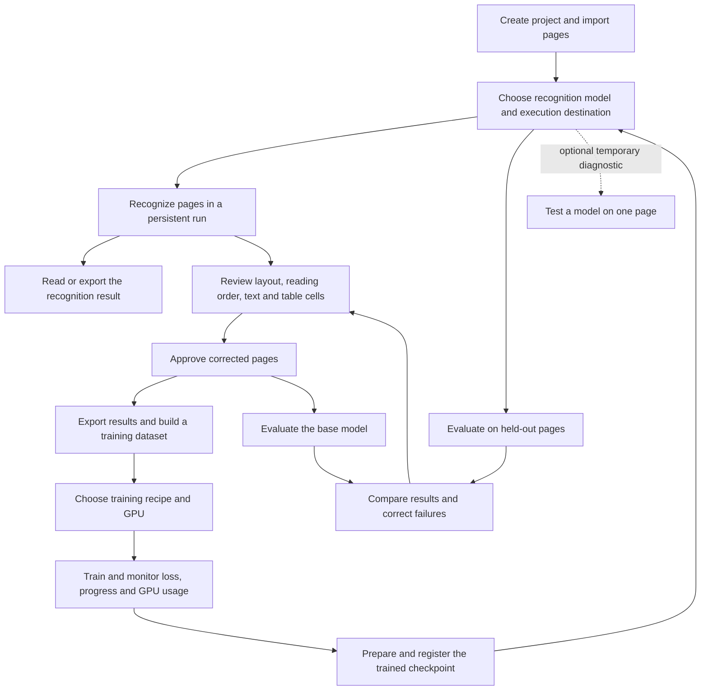

# User workflow verification — 21 October 2026

## Expected journey

Inference and training have separate execution choices. Local inference includes MLX on compatible Apple Silicon models and CUDA where supported; remote inference includes providers and compatible endpoints. CUDA training follows each model's official recipe and supports rented GPUs or existing local/SSH infrastructure. MLX inference availability does not imply MLX training support.

## Browser evidence

The existing instance was inspected without editing its research annotations. A separate instance with an isolated data directory was used for mutations. Its single synthetic scan contains five lines of shipping archive text. No GPU rental, paid run or production training was launched.

| Use case | Browser actions and observed result | Correction |
|---|---|---|
| Create/import | Created an upload-origin project, then a separate server-folder project; registered one synthetic page successfully. | Archive import remains the entry point. Browser upload could not be exercised because the Chrome extension lacked file URL permission. |
| Recognize and return later | Selected local OCR, selected the page, launched persistent run 1, opened its completed result. | Model unavailability permits local OCR fallback; explicit engine choices are respected. |
| Understand saved results | Inspected an existing run whose generated blocks had subsequently been replaced. It incorrectly said there were no blocks. | Display immutable detected count separately from the current page review state. |
| Export | Clicked raw TXT export and read the downloaded file: all five synthetic lines were present. | Export verified despite the browser download event timing out. |
| Review and approve | Opened the synthetic run in Studio, corrected the first line, verified all five blocks and approved the page. | Removed duplicated run context from the full Studio view. |
| Review tables | Opened an existing 61×16 table: its block was verified while 0/513 cells were verified. | Labels now distinguish table block review from cell verification. No research cells were edited. |
| Build dataset | Built from the approved synthetic page: one layout and five text samples, one training page, zero validation pages. | Show next training action and explicit missing-validation guidance; detailed sample warnings are expandable. |
| Configure training | Followed dataset → new training, checked project continuity and unsupported recipe gating. | Separate new configuration from run monitoring. Removed generic speed/quality presets; official recipe defaults remain, with advanced parameters and the measured MonkeyOCR 8 GB adjustment. |
| Monitor training | Inspected an existing completed run and its checkpoint preparation failure. | Duration stops at completion; failed preparation has an actionable next step; local hardware is not inferred from a historical remote GPU. Charts and status lead; logs are opened explicitly. |
| Use trained model | Inspected checkpoint preparation and registered-model actions. | Require preparation and inference setup before evaluation; preselect the registered model in setup. Successful preparation and serving were not executed. |
| Choose inference destination | Inspected the active MLX model, catalogue and compatible endpoint form without saving. | Generic endpoint labels replace vLLM-specific assumptions. Standalone SSH inference provisioning is not offered; compatible endpoints can represent an already served remote model. |
| Temporary model diagnostic | Ran local OCR on an existing page (425 lines), then followed the action into persistent recognition. | Diagnostic is contextual under Models, named “Test model”; project and page selection survive the handoff. It is absent from primary navigation. |
| Evaluate | Opened baseline evaluation with one approved synthetic page and an unavailable MonkeyOCR endpoint. | Missing held-out pages block post-training evaluation. Local start is offered only when the registry declares the selected model runnable on this machine. No GPU evaluation was launched. |

## Screenshots

- [Reviewed synthetic page](screenshots/workflow-reviewed-20261021.png)
- [Simplified training configuration](screenshots/workflow-training-20261021.png)

## Verification limits

This is a workflow audit, not proof that every model/provider combination works. GPU provisioning, full training, checkpoint preparation, GPU evaluation, benchmark execution, team roles, concurrent editing, geometric rectification and complex table editing were not executed. The historical archive was inspected read-only. Chrome control stopped during export; the remaining synthetic workflow continued in the integrated browser.

The frontend production build passed. Seven targeted Vitest files passed 47 tests, covering workflow navigation, result counts, prerequisite guidance, evaluation holdout gating, training defaults and table verification labels. The final local-serving compatibility change was followed by another production build.

## Visual simplification — 22 October 2026

The browser review found that the shared container itself added too much emphasis: every
section had a frame, title plate and filled header. Training added individually boxed metrics,
an expanded comparison table and an empty GPU history panel. Models repeated navigation in a
“More tools” section, while Recognize displayed eight historical run states beside the main action.

Changes applied:

- Plain section headings, softer rules and text navigation replace frames and title plates.
- Standard pages have a 1280 px content limit; Studio and table routes remain full width.
- Training metrics are unboxed; missing values are omitted. The learning curve comes before
  evaluation details. Completed runs without GPU history do not render an empty GPU panel.
- Run comparison and checkpoint paths are disclosed on request; repeated run status is removed.
- Recognition history and generated dataset files start closed. Duplicate model trial and
  tool navigation links are removed.

Browser checks on the existing local instance covered Recognize, Fine-tuning, Dataset, Models
and the training monitor. Opening recognition history revealed the existing run links. Opening
“Show logs” displayed the run log, and closing it restored the chart view. Existing data were
not edited and no new model or GPU job was launched. The production frontend build passed;
this visual pass did not rerun the previous unit suite or perform new GPU execution checks.

Screenshots: [recognition](screenshots/recognize-light-20261022.png),
[training monitor](screenshots/training-light-20261022.png).

The supporting Mobbin reference was [Linear’s project issue view](https://mobbin.com/screens/212fda35-366e-4dc0-a1d1-3b679659d6ab):
its inspected image uses plain headings, rows and a separate properties surface. It informed
hierarchy and disclosure, rather than the OCR workflow itself.

## Navigation review — 22 October 2026

The next pass followed the available signed-in pages: Archive, project list and creation
(cancelled without saving), project detail/registry, Recognize, Results, Studio, the table
workspace dialog, Fine-tuning overview, Dataset, training monitor and new configuration,
Evaluation, Benchmark, Models, model trial, Users and all five Settings sections. Authentication,
first-instance setup, invitation acceptance and forced-password pages were not exercised: the
existing administrator session was retained. The standalone reader/viewer paths were not
validated under a second account.

Concrete corrections:

| Friction observed | Change and browser evidence |
|---|---|
| Archive offered evaluation while checkpoint preparation had failed. | Archive now links to preparation; revisiting showed “Prepare the trained model”. |
| Archive rendered 361 thumbnail rows immediately. | Render 80 initially, with additional pages on request; filename/page metadata search covers the entire collection. |
| Registry rendered 361 editable rows and offered no search. | Render 50 initially and add full-collection search. Searching `LSI_17186` found a page beyond the first 50. Existing global bulk-selection and approval semantics remain. Search and loading-more remain usable for readers outside the disabled editing fieldset. |
| Loading looked like “0 pages” or an empty archive. | Explicit loading presentation in archive, registry and recognition; project header waits for project metadata. |
| Results devoted a whole column to dozens of historical runs. | A single selector retains every run, date, provider, status and page count; browser selection successfully changed from run 32 to run 24. Export and review actions remain next to the result. Run switching has loading feedback. |
| Benchmark mixed 11 ready pages with hundreds of disabled choices. | Initially show ready pages; a checkbox restores pages needing review. Launch is disabled without ready pages or selected model targets. No benchmark was launched. |
| Advanced model settings initially selected TeleOCR while MinerU2.5 was active. | Prefer the active adapter if available; browser revisit showed MinerU2.5 with its own workflow parameters. |
| Users opened with an entire creation form above the user list. | Creation is in a named disclosure; roles, invitations, password and account controls remain. |
| Studio changed a legacy approved page to “Annotated” on reading unassigned team workflow state. | Distinguish explicit workflow mutations from passive reads. Browser revisit of page 5 retained “Approved”; annotations and approval were not changed to obtain this result. |

Screenshots: [direct result access](screenshots/results-direct-20261022.png),
[registry search](screenshots/registry-search-20261022.png).

This pass changes presentation and navigation, not model recipes, OCR resolution, verification
requirements, table structure, export formats or dataset splitting. No rental, training,
benchmark, evaluation, account creation or permission update was launched. The frontend build
passed. GPU execution, browser timing benchmarks and the full automated suite were not rerun.

Remaining observations for a subsequent focused pass: local model setup can show a startup
state while the global endpoint reports ready, and some adapter-specific technical descriptions
remain in Italian in the English interface. These were observed but are not claimed fixed here.

## Remaining steps — 22 October 2026

- Local setup: inspected the startup log, which showed successful `/v1/models` responses while
  the checklist still said loading. The checklist now accepts the active endpoint's verified
  availability only when the managed running process, adapter, loopback host and port match.
  Browser reload showed “Serving on :8888” and “Ready to use” for MinerU2.5. Process lifecycle
  remains separate and the server was not restarted. Logs remain available after readiness,
  collapsed by default even on errors.
- Advanced model settings: translated the MinerU description and parameter labels in all three
  languages, with official parameter names retained in tooltips. The English browser view showed
  the translated description, formula/image options and layout dimensions with original values.
- Invitation recovery: opened `/invito` without a token in a separate browser tab. The invalid
  invitation now offers “Go to Tabularium”; clicking it returned to recognition with the existing
  session. No invitation or account was created. Authentication forms have dedicated spacing;
  registration exposes and enforces the existing eight-character minimum before submission.
- Standalone table workspace: opened existing block 1876, inspected the 71×8 sheet and distinct
  block/cell verification counters, switched from table crop to full page, and used “Back to
  annotation”. The browser returned to the same project/page. No grid text, structure or
  verification state was edited.

The frontend production build passed. Login, first-admin setup, valid invitation acceptance,
forced password change, second-user permissions and paid GPU execution remain outside browser
execution: completing those flows changes credentials, users or resources. Their source paths
were reviewed; they are not reported as end-to-end verified. The remaining review does not
establish that every provider, model and role combination has passed execution.

Model setup navigation and checklist markers were also flattened, with a single primary
recognition action. See [ready local model](screenshots/models-ready-20261022.png).

Local setup now waits for the first process-status response before showing lifecycle actions,
rather than briefly claiming the server is stopped. A failed first read offers retry. Status
polling is reset when the selected adapter changes. The final production build passed after
these changes.
