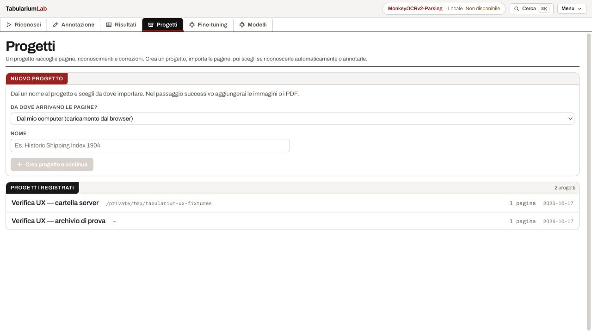
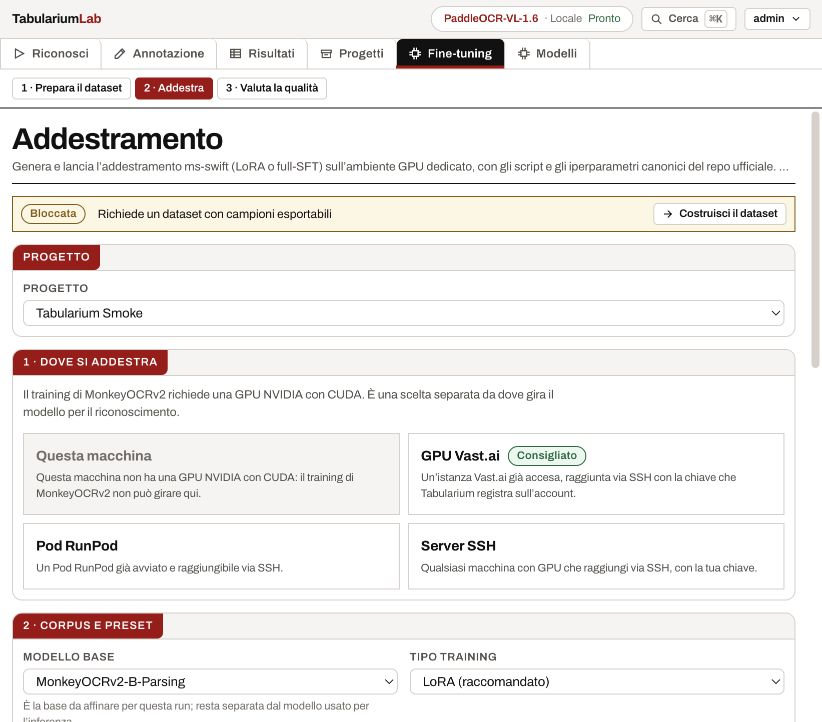
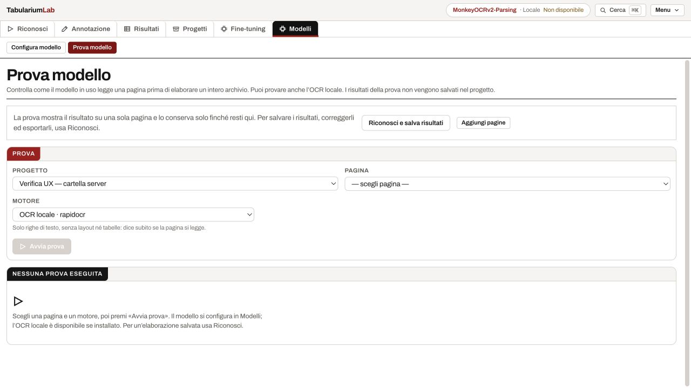

# Audit dei percorsi — 17 ottobre 2026

Verifica effettuata nel browser sull’istanza esistente (`127.0.0.1:8787`) e su
un’istanza isolata (`127.0.0.1:8788`, dati in `/tmp/tabularium-ux-audit`).
Creazioni, importazioni, riconoscimento e correzioni hanno usato solo una scansione
sintetica; i progetti dell’utente sono stati consultati senza modificarli.

## Problemi corretti

- Fine-tuning nascosto in fondo alla configurazione Modelli: ora ha un ingresso
  globale e tre sottosezioni persistenti, Dataset → Addestramento → Valutazione.
- Nessun ingresso chiaro per creare un altro progetto quando esiste già un archivio:
  Progetti è nel rail e Nuovo progetto è raggiungibile anche da Riconosci e Archivio.
- Creazione vincolata a un percorso assoluto sul server anche per chi vuole caricare
  dal browser: ora si sceglie la provenienza, basta un nome nel percorso browser,
  e si entra subito nel progetto appena creato. Questo diventa il progetto attivo.
- Importazione poco distinta dalla scansione: immagini/PDF singoli e cartelle dal
  computer hanno pulsanti espliciti; la scansione della cartella server compare
  solo quando il progetto ne ha una. Attività, protocollo e pilot sono richiusi.
- Playground senza uno scopo evidente: rinominato Prova modello, con spiegazione
  del risultato temporaneo e collegamento a Riconosci per salvarlo e revisionarlo.
- Avviso di incompatibilità locale mentre il modello MLX risponde: soppresso;
  il verdetto usa anche la compatibilità locale del modello. Nomi leggibili e
  destinazione senza duplicati nel riepilogo di Riconosci.
- Training che dichiara mancante il dataset ma rimanda allo Studio: rimanda al dataset.
- Prerequisiti derivati dal completamento di tutto l’archivio: ora dipendono dalla
  singola attività. Un campione approvato basta per preparare i dati e valutare una
  baseline; un dataset utile basta per passare all’addestramento.
- Un dataset vuoto considerato pronto: escluso da `datasetUsable` e dichiarato
  come prerequisito da risolvere, anche quando i file di export esistono.
- Prova OCR che mostra errori del VLM spento: gli avvisi seguono il motore scelto.
  Cambiare pagina azzera inoltre testo e overlay della prova precedente.

## Verifica nel browser

| Percorso | Esito e limite della verifica |
| --- | --- |
| Progetto → import dal browser | Creato senza cartella server, caricato un PNG, registrata una pagina con anteprima. |
| Progetto → cartella server | Creato con cartella sintetica, registrata una pagina dalla cartella. |
| Progetto → Riconosci | Il progetto nuovo risulta già selezionato. |
| Riconosci → Risultati | OCR locale completato: cinque blocchi sulla pagina sintetica. |
| Risultati → export | Scaricato e letto il TXT originale; presenti le cinque righe riconosciute. |
| Risultati → Studio | Corretti e verificati cinque blocchi, riordinati, approvata la pagina sintetica. |
| Studio → tabella | Aperta la vista di lavoro di una tabella esistente, 67 × 12, senza editarla. |
| Annotazioni → dataset | Generati un campione layout e cinque campioni testo dalla pagina approvata. |
| Fine-tuning → Addestra | Controllati ingresso, sottosezioni, scelta GPU e blocco per dataset vuoto con link corretto. Nessuna run GPU avviata. |
| Fine-tuning → Valuta | Controllato blocco senza gold e collegamento allo Studio; nessuna valutazione VLM eseguita. |
| Modelli → configurazione | Ispezionati modello attivo, destinazione e checklist; nessun cambio di modello o provider. |
| Modelli → Prova modello | Eseguita prova OCR: cinque blocchi temporanei; controllato l’ingresso verso il riconoscimento persistente. |
| Archivio | Ispezionati corpus, filtri, rassegna e collegamenti alle attività. |
| Account → Impostazioni | Ispezionati ingresso, zone, profilo e accesso a Utenti; nessuna modifica a credenziali, permessi o account. |
| Lingue | Controllata la creazione progetto in italiano, inglese e francese; ripristinato italiano. |

## Verifiche automatiche

- Frontend: typecheck e build completati; 32 file Vitest, 200 test passati.
- Backend: progetti, autenticazione, dataset e catalogo i18n, 52 test passati.
- Aggiunte regressioni per progetto senza cartella + upload + anteprima, dataset
  vuoto, campione parziale, baseline prima del training e sezione padre attiva.
- `git diff --check` senza errori.
- La build segnala ancora i chunk voluminosi del foglio Univer e dei dizionari:
  non impediscono la build; non sono stati modificati in questo intervento.

## Limiti e osservazioni residue

La creazione senza cartella richiede il backend aggiornato: il processo già in
ascolto su 8787 va riavviato. La build frontend è già aggiornata; l’API nuova è
stata collaudata sull’istanza isolata. Non sono stati noleggiati server né avviati
training o valutazioni VLM; questi percorsi richiedono una verifica con GPU e
modello scelti. Setup/login/invito/password non sono stati ripercorsi via browser:
l’istanza esistente era già autenticata; la suite auth è passata.

Durante le correzioni rapide nell’istanza isolata con autenticazione disattivata
è comparso un avviso live attribuito a «local» dopo una modifica propria. I dati
sono stati salvati e l’approvazione è riuscita; resta da verificare separatamente
la corsa fra risposta REST ed eco WebSocket nel lavoro collaborativo. Non è stata
cambiata la collaborazione live in questo intervento.

## Schermate

## Follow-up — 21 October 2026

See [browser use-case verification](UX_USE_CASE_VERIFICATION.md) for the subsequent browser audit, synthetic recognition-to-dataset walkthrough, implementation changes, screenshots and explicit verification limits.

## Follow-up — 23 October 2026: live training visibility

The live monitor exposes current/next stage, separate phase and rental durations,
dataset composition, real optimizer progress, trainer ETA and latest recorded
activity. File transfer progress uses measured completed files and bytes; provider
container substeps are named without fabricated percentages. Steps are shown once,
instant GPU memory is no longer called a peak, and empty quality panels are hidden.
A run reaching its last step is distinguished from a usable, evaluated checkpoint.
See [the trial record](APPROVAL_EXPORT_REPAIR_20261023.md) for real outcomes and limits.
