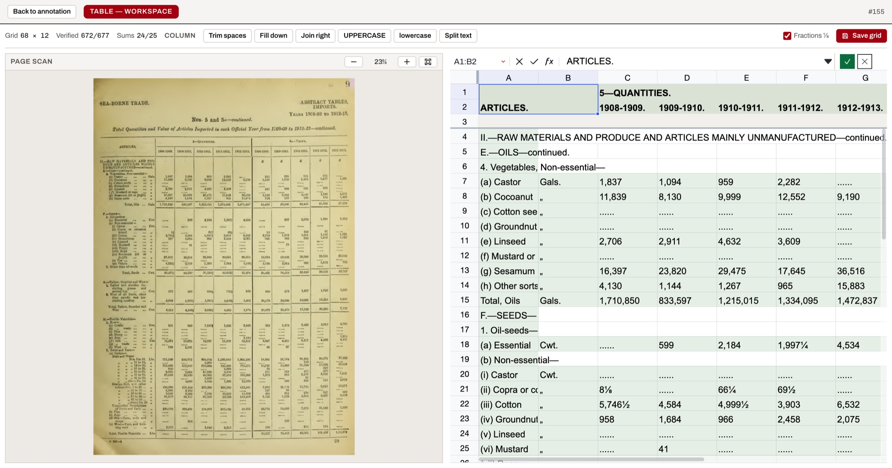
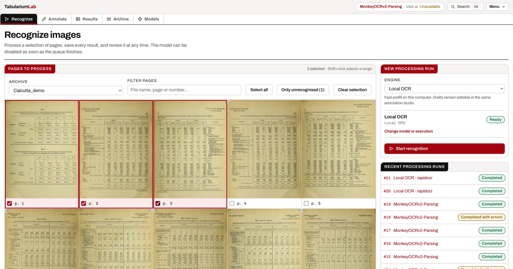
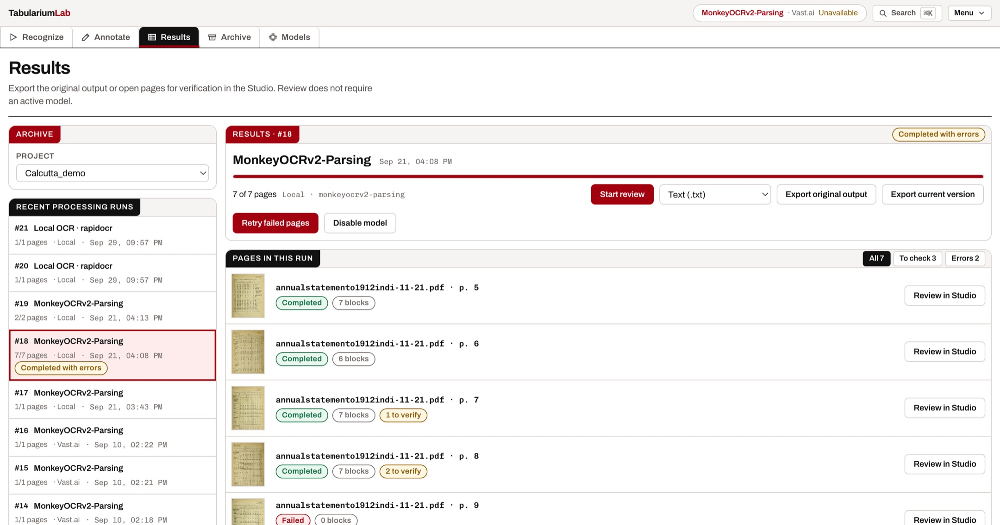
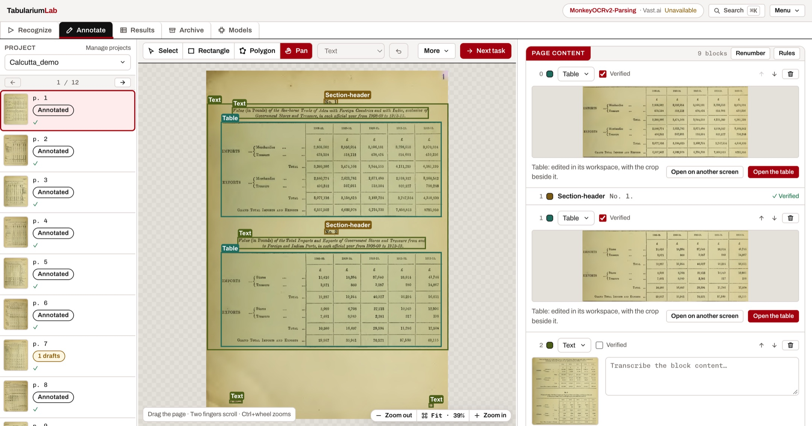

# Tabularium

**State-of-the-art OCR for historical documents, made simple for researchers.**
Recognize your archive with the best open-weight models, correct the results,
and fine-tune a model on your own pages, all from one app and without writing
a line of code.




*A page of the 1912–13 Annual Statement of Sea-borne Trade, recognized and then
corrected in Tabularium: 68 × 12 cells, 672 of 677 verified, 24 of 25 column
sums adding up.*

## Why

Document AI moves fast. Every few months a new open-weight OCR model beats the
last one, and each comes with its own serving stack, prompt format, output
conventions and training recipe. For a historian, an archivist or a
computational social scientist, the gap between "this model is state of the
art" and "this model is reading my archive" is weeks of engineering.

Historical sources make it harder still. Old typefaces, faded ink, curved
pages, dense multi-column layouts and tables with no ruling lines are exactly
where off-the-shelf models stumble, and where a small amount of fine-tuning on
your own pages pays off the most.

Tabularium closes that gap:

- **Simple**: pick a model and where it runs (your laptop or a rented GPU),
  then recognize, review and export. Runtimes install themselves.
- **State of the art**: it drives each model with its official prompts,
  pipeline and training recipe, so you get the result the authors measured
  rather than an approximation.
- **Model-agnostic**: your annotations are stored independently of any model.
  When a better model comes out, add it and keep everything you have done.
- **No GPU? No problem**: rent one on Vast.ai, RunPod or Modal, or use any
  server you can reach over SSH. Tabularium sets it up, serves the model and
  stops it when you switch inference off, all from the interface.
- **Built for research teams**: multi-user from day one. Share projects, assign
  pages to annotators and reviewers, and see who is working where, live.
- **Yours**: self-hosted. Your scans and annotations stay on your server, and
  go to a GPU only when you decide to send them.

> *Tabularium*: the public archive where ancient Rome kept its *tabulae*,
> the records **and** the tables.

## Two paths, use one or both

```
Inference     import scans → choose a model → recognize → review → export
Fine-tuning   correct pages → build dataset → train → evaluate → recognize with your model
```

Many projects only ever need inference. When the base model isn't good enough
on your sources, the pages you corrected along the way are already your
training set.

## Features

**Inference**
- Bulk recognition of scans and multi-page PDFs in persistent sessions that
  keep running if you close the browser.
- Runs on this machine (NVIDIA, or Apple Silicon for MLX-ported models) or on
  external GPU providers: **Vast.ai, RunPod, Modal** or any SSH host. Pick a
  GPU, and Tabularium sets up the server and tunnel; stopping inference stops
  the instance you rented, so you aren't billed for idle time. Each option says
  *before* you click whether it can host the chosen model.
- **LlamaIndex OCRia-1** is also available as a hosted OCR provider with the
  user's own LlamaCloud key stored in the backend vault, including native tier,
  effort, table-quality, language, image, output and job-control settings.
- A CPU OCR engine for when you have no GPU at all.
- Export as JSON, CSV or plain text, either the raw model output or your
  corrected version.

**Review and annotation**
- A studio for layout blocks, reading order and transcription, with
  project-specific labels and transcription rules.
- A spreadsheet-style workspace for tables, including the hard ones: no ruling
  lines, drifting columns, merged cells, arithmetic checks on column sums.
- Model output is a **draft** until someone confirms it; reports always say how
  much is still unverified.

**Fine-tuning and evaluation**
- One-click datasets in the exact format each model's official trainer
  expects, split by page.
- Training with each model's official defaults (LoRA or full), a separate view for new
  runs and run history, loss charts and logs on demand. A VRAM check blocks configurations
  that cannot fit the selected GPU.
- Benchmarks of several models, or several checkpoints, on your own approved
  pages: layout IoU, reading order, TEDS for tables, CER/WER for text.

**Fine-tuning on rented GPUs**
- Training can run on this machine or on a remote GPU (SSH, Vast.ai, RunPod),
  with the same live logs and charts.

**Multi-user, for research teams**
- One instance for the whole lab: admin / editor / viewer roles, invitations
  by link, and per-project sharing with edit or read-only access.
- Annotator → reviewer workflow per page: submit, request changes, approve,
  with a personal "to annotate / to review" queue.
- Live presence in the studio: see who is on the same page, and get their
  changes without reloading.
- Interface in English, Italian and French.

| Recognize | Review | Annotate |
|---|---|---|
|  |  |  |

## Get started

<div class="grid cards" markdown>

- **[Install Tabularium](guide/installation.md)**: four commands, no GPU needed.
- **[Supported models](models.md)**: what runs where, and how verified it is.
- **[Rent a GPU](guide/cloud-gpus.md)**: Vast.ai, RunPod, Modal, SSH.
- **[Fine-tune a model](guide/training.md)**: official recipes per model.

</div>

### Workspace presentation

Work pages use plain section headings and a readable content width. Recognition history,
run comparisons, generated files and checkpoint paths open on request. Training leads with
metrics and charts; logs remain available through an explicit control. Studio and table
editors retain the full workspace width.

Archive and registry searches cover every page, with additional rows loaded on request.
Results keep all recognition runs in one selector. Benchmark page selection starts with ready
pages and can also show pages needing review. These presentation choices preserve bulk actions,
verification requirements and model-specific configuration.

Local model setup reconciles startup progress with the verified active endpoint on the same
model and port. Server logs stay available on request after startup. Model-specific settings
keep official parameter names in tooltips alongside localized labels. Invalid invitation links
include a return to the application.

Real GPU workflow evidence: [Vast.ai trial, 22 October 2026](VAST_WORKFLOW_TRIAL_20261022.md).

### Automatic comparison on the training GPU

Automatic MonkeyOCRv2 training compares the base and fine-tuned checkpoints sequentially
on the same rented GPU, using the run’s frozen held-out samples, before downloading the model
and releasing the instance. The monitor shows progress and metric deltas, with logs on demand.
Training success and comparison success are reported separately. See
[the comparison workflow](TRAINING_COMPARISON_20261023.md).

Approval verifies table content as well as layout. Dataset coverage is checked before GPU rental;
see [the approved-table workflow repair](APPROVAL_EXPORT_REPAIR_20261023.md).
